<!-- Generated by porting/tools/depgraph.py from `go list` at the pinned commit. Do not edit. -->
# Go package dependency graph

Level 0 packages import no other Gorse package; a package at level N imports only packages at lower levels.
`src` counts hand-written non-test lines (generated `*.pb.go` excluded, build-tagged variants included); `test` counts `*_test.go` lines.

| Level | Package | src | test | Imports (Gorse packages) |
|---|---|---|---|---|
| 0 | `client` | 389 | 372 |  |
| 0 | `cmd/version` | 26 | 0 |  |
| 0 | `common/blas` | 114 | 0 |  |
| 0 | `common/copier` | 169 | 191 |  |
| 0 | `common/decision` | 144 | 115 |  |
| 0 | `common/encoding` | 112 | 55 |  |
| 0 | `common/event` | 73 | 66 |  |
| 0 | `common/floats` | 1717 | 849 |  |
| 0 | `common/jsonutil` | 41 | 44 |  |
| 0 | `common/log` | 246 | 90 |  |
| 0 | `common/mock` | 154 | 119 |  |
| 0 | `common/reranker` | 179 | 71 |  |
| 0 | `common/sizeof` | 114 | 64 |  |
| 0 | `protocol` | 21 | 0 |  |
| 0 | `storage` | 308 | 18 |  |
| 1 | `cmd/gorse-cli` | 1696 | 603 | `client`, `cmd/version` |
| 1 | `common/expression` | 189 | 175 | `protocol` |
| 1 | `common/heap` | 211 | 164 | `common/encoding` |
| 1 | `common/monitor` | 242 | 146 | `protocol` |
| 1 | `common/util` | 382 | 170 | `common/log` |
| 1 | `storage/vectors` | 2727 | 802 | `common/floats`, `protocol`, `storage` |
| 2 | `common/ann` | 526 | 297 | `common/encoding`, `common/heap` |
| 2 | `common/datautil` | 185 | 28 | `common/log`, `common/util` |
| 2 | `common/parallel` | 310 | 254 | `common/util` |
| 2 | `config` | 1053 | 620 | `common/expression`, `common/log`, `common/util`, `storage` |
| 2 | `model` | 461 | 187 | `common/log`, `common/util` |
| 2 | `storage/cache` | 2233 | 1366 | `common/log`, `common/util`, `protocol`, `storage` |
| 3 | `common/nn` | 2346 | 1390 | `common/floats`, `common/parallel`, `protocol` |
| 3 | `storage/blob` | 716 | 353 | `common/log`, `config`, `protocol` |
| 3 | `storage/data` | 4356 | 1636 | `common/expression`, `common/jsonutil`, `common/log`, `config`, `protocol`, `storage` |
| 3 | `storage/meta` | 234 | 193 | `model`, `storage` |
| 4 | `dataset` | 1155 | 507 | `common/encoding`, `common/floats`, `common/log`, `common/util`, `model`, `storage/data` |
| 5 | `logics` | 1905 | 1529 | `common/ann`, `common/decision`, `common/encoding`, `common/expression`, `common/floats`, `common/heap`, `common/log`, `common/reranker`, `common/util`, `config`, `dataset`, `storage`, `storage/cache`, `storage/data`, `storage/vectors` |
| 5 | `model/cf` | 1046 | 430 | `common/encoding`, `common/floats`, `common/heap`, `common/log`, `common/monitor`, `common/parallel`, `common/util`, `dataset`, `model`, `protocol`, `storage/meta` |
| 5 | `model/ctr` | 2437 | 1000 | `common/encoding`, `common/floats`, `common/jsonutil`, `common/log`, `common/monitor`, `common/nn`, `common/util`, `dataset`, `model`, `storage/meta` |
| 6 | `server` | 2532 | 2406 | `cmd/version`, `common/event`, `common/expression`, `common/heap`, `common/jsonutil`, `common/log`, `common/util`, `config`, `logics`, `protocol`, `storage`, `storage/cache`, `storage/data`, `storage/vectors` |
| 6 | `worker` | 1319 | 1173 | `cmd/version`, `common/expression`, `common/floats`, `common/log`, `common/monitor`, `common/parallel`, `common/util`, `config`, `logics`, `model/ctr`, `protocol`, `storage`, `storage/blob`, `storage/cache`, `storage/data`, `storage/vectors` |
| 7 | `cmd/gorse-server` | 105 | 0 | `cmd/version`, `common/log`, `common/util`, `server` |
| 7 | `cmd/gorse-worker` | 102 | 0 | `cmd/version`, `common/log`, `common/util`, `worker` |
| 7 | `master` | 4539 | 2436 | `cmd/version`, `common/event`, `common/expression`, `common/log`, `common/monitor`, `common/parallel`, `common/sizeof`, `common/util`, `config`, `dataset`, `logics`, `model`, `model/cf`, `model/ctr`, `protocol`, `server`, `storage`, `storage/blob`, `storage/cache`, `storage/data`, `storage/meta`, `storage/vectors`, `worker` |
| 8 | `cmd/gorse-bench` | 600 | 0 | `common/floats`, `common/heap`, `common/log`, `common/parallel`, `config`, `dataset`, `logics`, `master`, `model/cf`, `model/ctr`, `storage`, `storage/cache`, `storage/data` |
| 8 | `cmd/gorse-in-one` | 185 | 0 | `client`, `cmd/version`, `common/log`, `config`, `master`, `storage/data` |
| 8 | `cmd/gorse-master` | 79 | 0 | `cmd/version`, `common/log`, `config`, `master` |

Totals: src 37678, test 19919 lines across 43 packages.

```mermaid
graph BT
  cmd_gorse_bench[cmd/gorse-bench] --> common_floats[common/floats]
  cmd_gorse_bench[cmd/gorse-bench] --> common_heap[common/heap]
  cmd_gorse_bench[cmd/gorse-bench] --> common_log[common/log]
  cmd_gorse_bench[cmd/gorse-bench] --> common_parallel[common/parallel]
  cmd_gorse_bench[cmd/gorse-bench] --> config[config]
  cmd_gorse_bench[cmd/gorse-bench] --> dataset[dataset]
  cmd_gorse_bench[cmd/gorse-bench] --> logics[logics]
  cmd_gorse_bench[cmd/gorse-bench] --> master[master]
  cmd_gorse_bench[cmd/gorse-bench] --> model_cf[model/cf]
  cmd_gorse_bench[cmd/gorse-bench] --> model_ctr[model/ctr]
  cmd_gorse_bench[cmd/gorse-bench] --> storage[storage]
  cmd_gorse_bench[cmd/gorse-bench] --> storage_cache[storage/cache]
  cmd_gorse_bench[cmd/gorse-bench] --> storage_data[storage/data]
  cmd_gorse_cli[cmd/gorse-cli] --> client[client]
  cmd_gorse_cli[cmd/gorse-cli] --> cmd_version[cmd/version]
  cmd_gorse_in_one[cmd/gorse-in-one] --> client[client]
  cmd_gorse_in_one[cmd/gorse-in-one] --> cmd_version[cmd/version]
  cmd_gorse_in_one[cmd/gorse-in-one] --> common_log[common/log]
  cmd_gorse_in_one[cmd/gorse-in-one] --> config[config]
  cmd_gorse_in_one[cmd/gorse-in-one] --> master[master]
  cmd_gorse_in_one[cmd/gorse-in-one] --> storage_data[storage/data]
  cmd_gorse_master[cmd/gorse-master] --> cmd_version[cmd/version]
  cmd_gorse_master[cmd/gorse-master] --> common_log[common/log]
  cmd_gorse_master[cmd/gorse-master] --> config[config]
  cmd_gorse_master[cmd/gorse-master] --> master[master]
  cmd_gorse_server[cmd/gorse-server] --> cmd_version[cmd/version]
  cmd_gorse_server[cmd/gorse-server] --> common_log[common/log]
  cmd_gorse_server[cmd/gorse-server] --> common_util[common/util]
  cmd_gorse_server[cmd/gorse-server] --> server[server]
  cmd_gorse_worker[cmd/gorse-worker] --> cmd_version[cmd/version]
  cmd_gorse_worker[cmd/gorse-worker] --> common_log[common/log]
  cmd_gorse_worker[cmd/gorse-worker] --> common_util[common/util]
  cmd_gorse_worker[cmd/gorse-worker] --> worker[worker]
  common_ann[common/ann] --> common_encoding[common/encoding]
  common_ann[common/ann] --> common_heap[common/heap]
  common_datautil[common/datautil] --> common_log[common/log]
  common_datautil[common/datautil] --> common_util[common/util]
  common_expression[common/expression] --> protocol[protocol]
  common_heap[common/heap] --> common_encoding[common/encoding]
  common_monitor[common/monitor] --> protocol[protocol]
  common_nn[common/nn] --> common_floats[common/floats]
  common_nn[common/nn] --> common_parallel[common/parallel]
  common_nn[common/nn] --> protocol[protocol]
  common_parallel[common/parallel] --> common_util[common/util]
  common_util[common/util] --> common_log[common/log]
  config[config] --> common_expression[common/expression]
  config[config] --> common_log[common/log]
  config[config] --> common_util[common/util]
  config[config] --> storage[storage]
  dataset[dataset] --> common_encoding[common/encoding]
  dataset[dataset] --> common_floats[common/floats]
  dataset[dataset] --> common_log[common/log]
  dataset[dataset] --> common_util[common/util]
  dataset[dataset] --> model[model]
  dataset[dataset] --> storage_data[storage/data]
  logics[logics] --> common_ann[common/ann]
  logics[logics] --> common_decision[common/decision]
  logics[logics] --> common_encoding[common/encoding]
  logics[logics] --> common_expression[common/expression]
  logics[logics] --> common_floats[common/floats]
  logics[logics] --> common_heap[common/heap]
  logics[logics] --> common_log[common/log]
  logics[logics] --> common_reranker[common/reranker]
  logics[logics] --> common_util[common/util]
  logics[logics] --> config[config]
  logics[logics] --> dataset[dataset]
  logics[logics] --> storage[storage]
  logics[logics] --> storage_cache[storage/cache]
  logics[logics] --> storage_data[storage/data]
  logics[logics] --> storage_vectors[storage/vectors]
  master[master] --> cmd_version[cmd/version]
  master[master] --> common_event[common/event]
  master[master] --> common_expression[common/expression]
  master[master] --> common_log[common/log]
  master[master] --> common_monitor[common/monitor]
  master[master] --> common_parallel[common/parallel]
  master[master] --> common_sizeof[common/sizeof]
  master[master] --> common_util[common/util]
  master[master] --> config[config]
  master[master] --> dataset[dataset]
  master[master] --> logics[logics]
  master[master] --> model[model]
  master[master] --> model_cf[model/cf]
  master[master] --> model_ctr[model/ctr]
  master[master] --> protocol[protocol]
  master[master] --> server[server]
  master[master] --> storage[storage]
  master[master] --> storage_blob[storage/blob]
  master[master] --> storage_cache[storage/cache]
  master[master] --> storage_data[storage/data]
  master[master] --> storage_meta[storage/meta]
  master[master] --> storage_vectors[storage/vectors]
  master[master] --> worker[worker]
  model[model] --> common_log[common/log]
  model[model] --> common_util[common/util]
  model_cf[model/cf] --> common_encoding[common/encoding]
  model_cf[model/cf] --> common_floats[common/floats]
  model_cf[model/cf] --> common_heap[common/heap]
  model_cf[model/cf] --> common_log[common/log]
  model_cf[model/cf] --> common_monitor[common/monitor]
  model_cf[model/cf] --> common_parallel[common/parallel]
  model_cf[model/cf] --> common_util[common/util]
  model_cf[model/cf] --> dataset[dataset]
  model_cf[model/cf] --> model[model]
  model_cf[model/cf] --> protocol[protocol]
  model_cf[model/cf] --> storage_meta[storage/meta]
  model_ctr[model/ctr] --> common_encoding[common/encoding]
  model_ctr[model/ctr] --> common_floats[common/floats]
  model_ctr[model/ctr] --> common_jsonutil[common/jsonutil]
  model_ctr[model/ctr] --> common_log[common/log]
  model_ctr[model/ctr] --> common_monitor[common/monitor]
  model_ctr[model/ctr] --> common_nn[common/nn]
  model_ctr[model/ctr] --> common_util[common/util]
  model_ctr[model/ctr] --> dataset[dataset]
  model_ctr[model/ctr] --> model[model]
  model_ctr[model/ctr] --> storage_meta[storage/meta]
  server[server] --> cmd_version[cmd/version]
  server[server] --> common_event[common/event]
  server[server] --> common_expression[common/expression]
  server[server] --> common_heap[common/heap]
  server[server] --> common_jsonutil[common/jsonutil]
  server[server] --> common_log[common/log]
  server[server] --> common_util[common/util]
  server[server] --> config[config]
  server[server] --> logics[logics]
  server[server] --> protocol[protocol]
  server[server] --> storage[storage]
  server[server] --> storage_cache[storage/cache]
  server[server] --> storage_data[storage/data]
  server[server] --> storage_vectors[storage/vectors]
  storage_blob[storage/blob] --> common_log[common/log]
  storage_blob[storage/blob] --> config[config]
  storage_blob[storage/blob] --> protocol[protocol]
  storage_cache[storage/cache] --> common_log[common/log]
  storage_cache[storage/cache] --> common_util[common/util]
  storage_cache[storage/cache] --> protocol[protocol]
  storage_cache[storage/cache] --> storage[storage]
  storage_data[storage/data] --> common_expression[common/expression]
  storage_data[storage/data] --> common_jsonutil[common/jsonutil]
  storage_data[storage/data] --> common_log[common/log]
  storage_data[storage/data] --> config[config]
  storage_data[storage/data] --> protocol[protocol]
  storage_data[storage/data] --> storage[storage]
  storage_meta[storage/meta] --> model[model]
  storage_meta[storage/meta] --> storage[storage]
  storage_vectors[storage/vectors] --> common_floats[common/floats]
  storage_vectors[storage/vectors] --> protocol[protocol]
  storage_vectors[storage/vectors] --> storage[storage]
  worker[worker] --> cmd_version[cmd/version]
  worker[worker] --> common_expression[common/expression]
  worker[worker] --> common_floats[common/floats]
  worker[worker] --> common_log[common/log]
  worker[worker] --> common_monitor[common/monitor]
  worker[worker] --> common_parallel[common/parallel]
  worker[worker] --> common_util[common/util]
  worker[worker] --> config[config]
  worker[worker] --> logics[logics]
  worker[worker] --> model_ctr[model/ctr]
  worker[worker] --> protocol[protocol]
  worker[worker] --> storage[storage]
  worker[worker] --> storage_blob[storage/blob]
  worker[worker] --> storage_cache[storage/cache]
  worker[worker] --> storage_data[storage/data]
  worker[worker] --> storage_vectors[storage/vectors]
```

